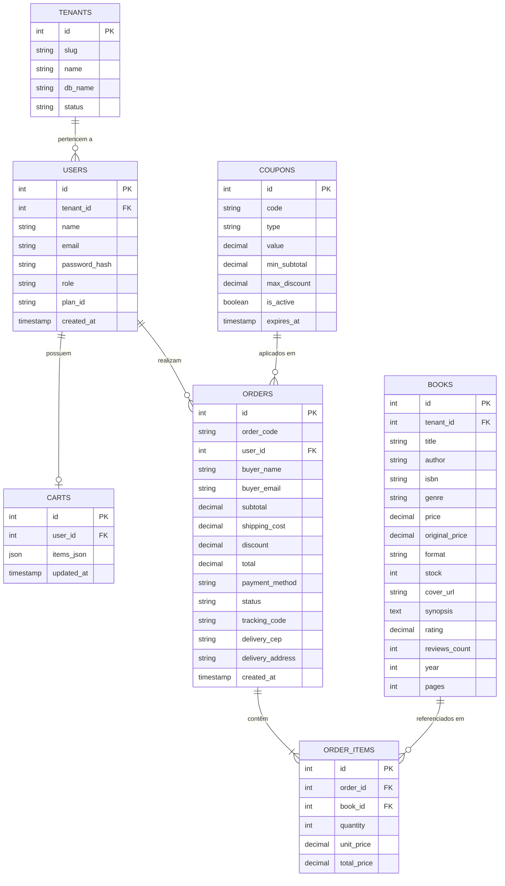

# 💾 Estrutura e Modelagem do Banco de Dados - Bibliotech

Este documento serve como guia de modelagem relacional para a criação e estruturação do banco de dados físico da plataforma **Bibliotech**.

---

## 1. Diagrama Entidade-Relacionamento (Conceitual)



---

## 2. Script DDL Sugerido (MySQL 8.0+)

```sql
-- 1. Tabela de Tenants (Multi-Tenant)
CREATE TABLE IF NOT EXISTS tenants (
  id INT AUTO_INCREMENT PRIMARY KEY,
  slug VARCHAR(50) NOT NULL UNIQUE,
  name VARCHAR(150) NOT NULL,
  db_name VARCHAR(100) NOT NULL,
  status ENUM('active', 'inactive') DEFAULT 'active',
  created_at TIMESTAMP DEFAULT CURRENT_TIMESTAMP
);

-- 2. Tabela de Usuários e Membros do Clube
CREATE TABLE IF NOT EXISTS users (
  id INT AUTO_INCREMENT PRIMARY KEY,
  tenant_id INT DEFAULT 1,
  name VARCHAR(150) NOT NULL,
  email VARCHAR(150) NOT NULL UNIQUE,
  password_hash VARCHAR(255) NOT NULL,
  role ENUM('admin', 'reader', 'librarian') DEFAULT 'reader',
  plan_id VARCHAR(50) DEFAULT 'visitante',
  created_at TIMESTAMP DEFAULT CURRENT_TIMESTAMP,
  FOREIGN KEY (tenant_id) REFERENCES tenants(id) ON DELETE SET NULL
);

-- 3. Tabela de Livros do Catálogo
CREATE TABLE IF NOT EXISTS books (
  id INT AUTO_INCREMENT PRIMARY KEY,
  tenant_id INT DEFAULT 1,
  title VARCHAR(255) NOT NULL,
  author VARCHAR(200) NOT NULL,
  isbn VARCHAR(30) NULL,
  genre VARCHAR(100) NOT NULL,
  price DECIMAL(10,2) NOT NULL,
  original_price DECIMAL(10,2) NULL,
  format VARCHAR(50) DEFAULT 'Brochura',
  stock INT DEFAULT 20,
  cover_url TEXT NULL,
  synopsis TEXT NULL,
  rating DECIMAL(3,2) DEFAULT 4.5,
  reviews_count INT DEFAULT 0,
  publication_year INT NULL,
  pages INT NULL,
  created_at TIMESTAMP DEFAULT CURRENT_TIMESTAMP,
  FOREIGN KEY (tenant_id) REFERENCES tenants(id) ON DELETE CASCADE
);

-- 4. Tabela de Cupons de Desconto
CREATE TABLE IF NOT EXISTS coupons (
  id INT AUTO_INCREMENT PRIMARY KEY,
  code VARCHAR(50) NOT NULL UNIQUE,
  type ENUM('percentage', 'fixed', 'shipping') NOT NULL,
  value DECIMAL(10,2) NOT NULL,
  min_subtotal DECIMAL(10,2) DEFAULT 0.00,
  max_discount DECIMAL(10,2) NULL,
  is_active BOOLEAN DEFAULT TRUE,
  expires_at TIMESTAMP NULL,
  created_at TIMESTAMP DEFAULT CURRENT_TIMESTAMP
);

-- 5. Tabela de Pedidos (Orders)
CREATE TABLE IF NOT EXISTS orders (
  id INT AUTO_INCREMENT PRIMARY KEY,
  order_code VARCHAR(30) NOT NULL UNIQUE,
  user_id INT NULL,
  buyer_name VARCHAR(150) NOT NULL,
  buyer_email VARCHAR(150) NOT NULL,
  subtotal DECIMAL(10,2) NOT NULL,
  shipping_cost DECIMAL(10,2) NOT NULL,
  discount DECIMAL(10,2) DEFAULT 0.00,
  total DECIMAL(10,2) NOT NULL,
  payment_method VARCHAR(50) NOT NULL,
  status ENUM('pending', 'paid', 'preparing', 'shipped', 'delivered', 'cancelled') DEFAULT 'pending',
  tracking_code VARCHAR(50) NULL,
  delivery_cep VARCHAR(10) NOT NULL,
  delivery_address TEXT NOT NULL,
  created_at TIMESTAMP DEFAULT CURRENT_TIMESTAMP,
  FOREIGN KEY (user_id) REFERENCES users(id) ON DELETE SET NULL
);

-- 6. Tabela de Itens de Cada Pedido
CREATE TABLE IF NOT EXISTS order_items (
  id INT AUTO_INCREMENT PRIMARY KEY,
  order_id INT NOT NULL,
  book_id INT NOT NULL,
  quantity INT NOT NULL DEFAULT 1,
  unit_price DECIMAL(10,2) NOT NULL,
  total_price DECIMAL(10,2) NOT NULL,
  FOREIGN KEY (order_id) REFERENCES orders(id) ON DELETE CASCADE,
  FOREIGN KEY (book_id) REFERENCES books(id) ON DELETE RESTRICT
);

-- 7. Tabela de Carrinhos Sincronizados
CREATE TABLE IF NOT EXISTS user_carts (
  id INT AUTO_INCREMENT PRIMARY KEY,
  user_id INT NOT NULL UNIQUE,
  items JSON NOT NULL,
  updated_at TIMESTAMP DEFAULT CURRENT_TIMESTAMP ON UPDATE CURRENT_TIMESTAMP,
  FOREIGN KEY (user_id) REFERENCES users(id) ON DELETE CASCADE
);
```
